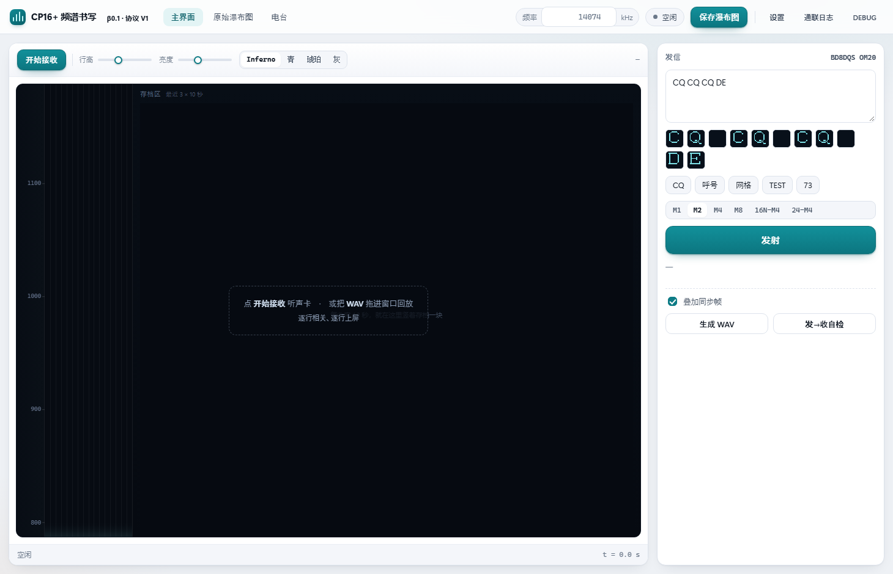
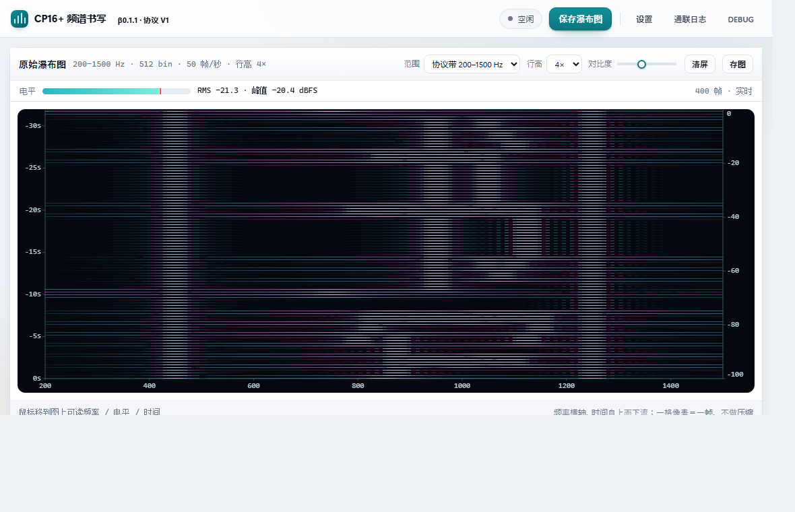

# CP16+ 频谱书写

把汉字"写"到无线电频谱上的低速通信协议，以及它的配套软件。

发送端把文字排成 16×16 点阵，用 16 个等间隔音频单音画在频谱上；接收端不需要解码器，
**人眼盯着瀑布图就能把字读出来**。机读层（DQPSK 控制信道）只传送呼号、网格、档位等
元信息，正文永远只由视觉层承载。

- 最新软件版本 **β0.1.1** · 协议版本 **V1**
- 作者：BD8DQS（BD8DQS@163.com）
- 许可：MIT（随包附带的 Hamlib 为 LGPL-2.1）

| 主界面 | 原始瀑布图窗口 |
|---|---|
|  |  |

## 特点

- **人眼可读**：正文不依赖解码成功率；信号弱时字迹变淡而不是突然消失
- **单通道**：默认只占 400 Hz 音频带宽，任何 SSB 电台 + 声卡即可
- **多档位**：单字 0.68–5.44 s 可选，弱信号下可加重垂直重复
- **点阵汉字**：16×16 字库，覆盖 GB2312 全部 7445 个汉字
- **机读参数**：呼号/网格/字符数由控制信道传送，另有每 10 秒的同步帧支持晚加入与失锁恢复
- **电台联动**：通过 Hamlib 支持 260+ 型号的 CAT 频率读写与 PTT

## 文档

- [协议规范](docs/CP16+协议规范.md)：频段、档位、视觉层编码、字库、控制信道、同步帧
- [软件使用手册](docs/CP16+软件使用手册.md)：安装、接收、发射、电台联动、日志导出、排障

## 安装

发行包里的 `CP16Plus.exe`：先读提示与 MIT 许可，再选安装目录
（默认 `C:\Program Files\CP16Plus`），安装需要管理员权限（UAC）。
装完桌面与开始菜单都有快捷方式。

绿色版用 `CP16Plus.zip`，解压后双击 `CP16+ 测试版.exe`。

## 从源码构建

需要 **Rust**（`stable-x86_64-pc-windows-gnu` 目标）与 Windows 10/11：

```powershell
rustup toolchain install stable-x86_64-pc-windows-gnu
.\rust\build.ps1 -Release -Audio            # 构建
.\rust\build.ps1 -Release -Audio -Pack      # 构建并打包到 dist\
```

- 若工程内有 `.toolchain\rustup`，脚本会优先使用它；否则自动用系统 rustup 的同名 target
- 链接只依赖 `rust-lld`（工具链自带），不需要 gcc/binutils
- 电台功能需要 `rust/third_party/hamlib/libhamlib-4.dll`（仓库内已附带；也可用
  `CP16P_HAMLIB_DIR` 指向别的 Hamlib 构建）
- 构建脚本会跑一遍界面脚本语法检查（`node --check`，没有 node 就跳过），
  并把图标写进 exe

## 目录

```
rust/crates/core     协议实现（编码/解码、同步、字库、导频）
rust/crates/cli      引擎与界面（本地 HTTP + SSE，界面是内嵌的一页 HTML）
rust/crates/audio    声卡采集与播放（cpal）
rust/crates/rig      电台 CAT（直接链接 Hamlib 4）
rust/crates/setup    安装包（自解压、许可页、快捷方式、卸载）
rust/assets          图标与许可文本
fonts/hzk16.cpf      16×16 字库（CPF1 容器）
ref/                 协议参考实现（Python，用于交叉验证）
tests/               回归脚本（同步、鲁棒性、SNR 扫描、参考实现对比）
samples/             测试样张（WAV + 真值）
tools/               图标生成与写入脚本
docs/                协议规范、使用手册、发行说明
dist/                发行版
```

## 测试

```powershell
python tests\run_all.py          # 全量回归
python tests\test_sync.py        # 同步帧与滑行
```

需要 Python 3 + numpy；`ref/` 是协议参考实现，`tests/compare_rust.py` 用它做逐位对比。

## 许可

本协议与参考实现采用 MIT 许可；`libhamlib-4.dll` 为 LGPL-2.1（动态链接，可自行替换），
许可全文见 `rust/third_party/hamlib/COPYING.LIB`。
